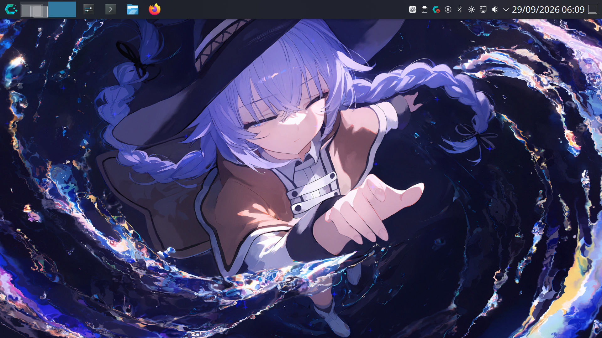
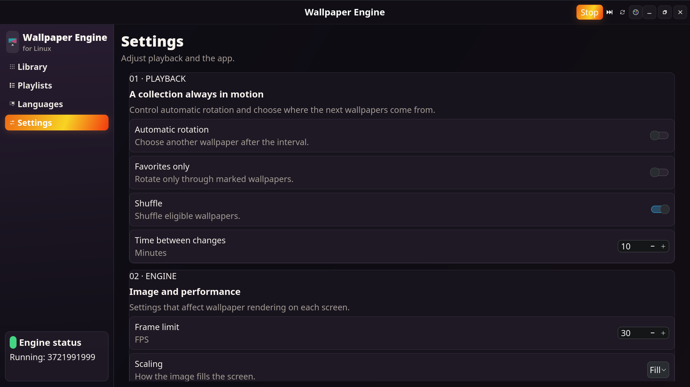
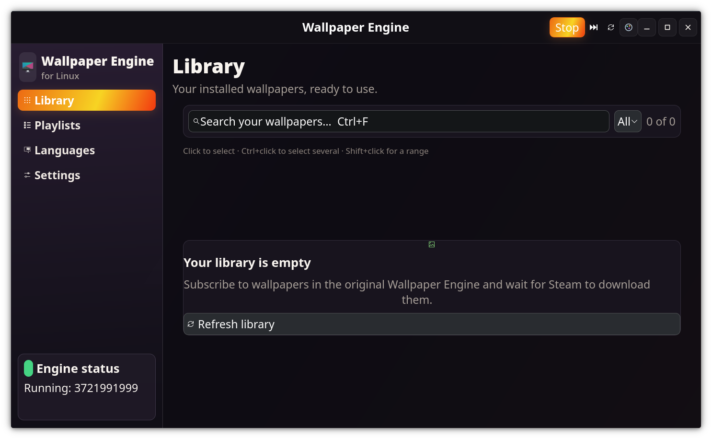
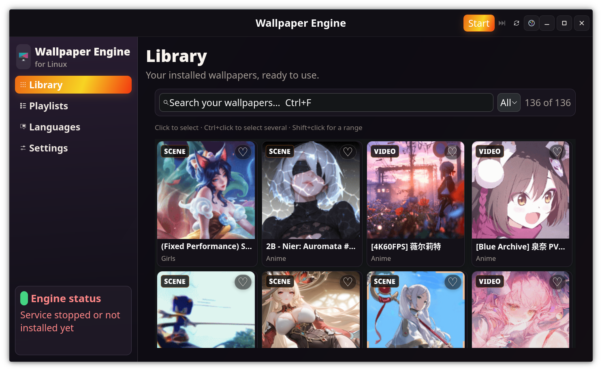

# Linux Wallpaper Engine

Run animated Wallpaper Engine wallpapers on Linux with the upstream OpenGL
renderer and this fork's optional GTK 4 desktop controller.

This repository is a fork of
[Almamu/linux-wallpaperengine](https://github.com/Almamu/linux-wallpaperengine).
The renderer is the original project's work; the GTK desktop app, its user
service, playlists, and related controls are additions maintained here. See
the [upstream README](https://github.com/Almamu/linux-wallpaperengine#readme)
for renderer-specific build prerequisites and the full command-line reference.

## Screenshots

The populated-library image was captured while the renderer was stopped; the
other app images show the running state indicated in the app.

### Wallpaper on the desktop



For the complete change inventory and upstream review notes, see
[`docs/FORK_CHANGES.md`](docs/FORK_CHANGES.md).

### GTK desktop controller







## What this fork adds

The GTK 4 app provides:

- A searchable library of locally downloaded Workshop projects, with previews,
  favorites, and scene/video filters.
- Playlists that can be created, renamed, reordered, and used for automatic
  wallpaper rotation. Wallpapers can be pinned to individual displays.
- Start, stop, and next controls, plus settings for rotation, shuffle, interval,
  frame rate, scaling, and audio mute.
- A user-level `systemd` service that keeps wallpapers running when the app
  window closes.
- English, Portuguese, German, Russian, Japanese, Chinese, Spanish, and Hindi
  interface translations, along with accent-color controls.

Subscribe to wallpapers in the original Wallpaper Engine app on Steam. Steam
downloads the subscribed projects; this app reads those local files and refreshes
its library. It does not download Workshop content itself or replace Steam.

## Compatibility

- KDE Plasma is the desktop environment tested with this controller and
  renderer.
- On Wayland, wallpaper rendering requires compositor support for
  `wlr-layer-shell`; monitor discovery on KDE Plasma Wayland uses
  `kscreen-doctor`.
- GNOME/Mutter on Wayland does not provide the renderer's required
  `wlr-layer-shell` protocol, so wallpaper rendering there is not supported.
- On X11, monitor discovery uses `xrandr`. A compositor or desktop that paints
  over the root background can hide the rendered wallpaper.
- When another app is maximized or fullscreen, the renderer releases the
  wallpaper scene's textures and framebuffers, then recreates them when the
  app is restored. It keeps the renderer process alive; the GPU driver still
  controls the VRAM clock and may keep display buffers allocated.
- The renderer requires a working OpenGL setup. The specific dependencies and
  supported options are documented by the
  [upstream project](https://github.com/Almamu/linux-wallpaperengine#readme).

## Install

Native installation is the only supported distribution path. A single
command installs everything: the required system packages (the only step
that uses sudo, and only after it asks for confirmation), the renderer
built from this checkout when it is not already in `PATH` or
`~/.local/bin`, and the desktop app with its user service.

```bash
./install.sh
```

The package step understands pacman (Arch Linux / CachyOS), apt
(Debian / Ubuntu), dnf (Fedora), and zypper (openSUSE), and lists the
exact missing packages before installing them. The renderer build updates
the git submodules and, on a first run, downloads the matching Chromium
Embedded Framework distribution, so it needs network access and can take
several minutes to compile. `./install.sh --dry-run` prints every step
without changing anything; `./install.sh --help` shows the full usage.

Verify the install by launching **Linux Wallpaper Engine** from the
application menu or by running `~/.local/bin/linux-wallpaperengine-app`,
and check that the background service is running:

```bash
systemctl --user status linux-wallpaperengine-app.service
```

On Arch Linux, the renderer is also published to the AUR as
`linux-wallpaperengine-git`, built from
[`packaging/archlinux/PKGBUILD`](packaging/archlinux/PKGBUILD) by
[`.github/workflows/arch.yml`](.github/workflows/arch.yml).

To remove the app and — when `./install.sh` built it — the renderer as
well:

```bash
./install.sh --uninstall
```

Both commands keep your preferences in `~/.config/linux-wallpaperengine`;
the uninstall also keeps your `build` directory.

### Manual installation

Only needed if you prefer to run each step yourself; otherwise use
`./install.sh` above.

#### Build the renderer from source

The desktop app uses a `linux-wallpaperengine` renderer installed in `PATH` or
`~/.local/bin`. Follow the
[upstream instructions](https://github.com/Almamu/linux-wallpaperengine#readme)
for renderer dependencies and Steam asset discovery. To build the renderer
from this checkout, clone with submodules, configure, build, and install it
under your home directory:

```bash
git clone --recurse-submodules https://github.com/xoykor/linux-wallpaperengine.git
cd linux-wallpaperengine
cmake -S . -B build -DCMAKE_BUILD_TYPE=Release
cmake --build build --parallel "$(nproc)"
cmake --install build --prefix "$HOME/.local/opt/linux-wallpaperengine"
mkdir -p "$HOME/.local/bin"
ln -s "$HOME/.local/opt/linux-wallpaperengine/linux-wallpaperengine" \
  "$HOME/.local/bin/linux-wallpaperengine"
```

The CMake configure step downloads the matching Chromium Embedded Framework
distribution and needs network access. If a package manager already installed
the renderer, skip the renderer build and install steps.

#### Install the desktop app

`./app/install.sh` installs only the desktop app for the current user. It
copies everything into your home directory — run it as your normal desktop
user, never with `sudo` — and `./app/install.sh --uninstall` removes it
again.

Prerequisites:

- The `linux-wallpaperengine` renderer in `PATH` or `~/.local/bin`
  (see [Build the renderer from source](#build-the-renderer-from-source)
  above).
- Python 3 with PyGObject and the GTK 4 and GdkPixbuf introspection typelibs.
- A working user `systemd` manager (`systemctl --user`).
- Monitor discovery for your session: `kscreen-doctor` on KDE Plasma Wayland
  or `xrandr` on X11.
- Optional, needed only for minimize-to-tray: the GTK 3 introspection plus
  the Ayatana AppIndicator (or `AppIndicator3`) package. Without it, the tray
  icon is unavailable and the rest of the app works normally.

Install the required packages for your distribution:

```bash
# Arch Linux / CachyOS
sudo pacman -S python python-gobject gtk4 gdk-pixbuf2

# Debian / Ubuntu
sudo apt install python3 python3-gi gir1.2-gtk-4.0 gir1.2-gdkpixbuf-2.0

# Fedora
sudo dnf install python3 python3-gobject gtk4 gdk-pixbuf2
```

Monitor discovery (pick what your session uses) and the optional tray
dependency:

```bash
# Arch Linux / CachyOS
sudo pacman -S xorg-xrandr kscreen     # monitor discovery
sudo pacman -S gtk3 libayatana-appindicator   # tray (optional)

# Debian / Ubuntu
sudo apt install x11-xserver-utils kscreen     # monitor discovery
sudo apt install gir1.2-gtk-3.0 gir1.2-ayatanaappindicator3-0.1   # tray (optional)

# Fedora
sudo dnf install xrandr kscreen         # monitor discovery
sudo dnf install gtk3 libayatana-appindicator-gtk3   # tray (optional)
```

From the repository root:

```bash
./app/install.sh
```

On a first install this copies the Python package to
`~/.local/lib/linux-wallpaperengine-app`, adds a launcher at
`~/.local/bin/linux-wallpaperengine-app`, adds the **Linux Wallpaper Engine**
menu entry with its icon, and enables and starts
`linux-wallpaperengine-app.service`.

Verify the install as described in [Install](#install) above. Other useful
service commands:

```bash
systemctl --user restart linux-wallpaperengine-app.service
journalctl --user -u linux-wallpaperengine-app.service -e
```

`./app/install.sh --uninstall` removes the app package, the launcher, the
menu entry, the icon, the `linux-wallpaperengine-app.service` unit, and the
`~/.config/autostart/linux-wallpaperengine-app.desktop` entry created by
**"Iniciar o aplicativo com o sistema"**. Your preferences in
`~/.config/linux-wallpaperengine` and the renderer installation are kept.

### Startup switches and the service

The application settings contain two separate startup switches:

- **"Ativar o serviço com a sessão"** ("Start the service with the session")
  enables or disables the `linux-wallpaperengine-app.service` systemd user
  unit (`systemctl --user enable|disable`), so wallpapers keep rendering
  after you log in even when the app window is closed.
- **"Iniciar o aplicativo com o sistema"** ("Start the app with the system")
  creates or removes `~/.config/autostart/linux-wallpaperengine-app.desktop`,
  so the control app window itself opens when you log in.

## Use the renderer directly

The GTK app is optional. The renderer can also be run from a terminal with a
Workshop ID or a path to a wallpaper directory:

```bash
linux-wallpaperengine 1845706469
linux-wallpaperengine ~/path/to/wallpaper
```

For renderer options, wallpaper properties, display selection, troubleshooting,
and additional examples, see the
[upstream command-line documentation](https://github.com/Almamu/linux-wallpaperengine#usage).

## License

This project is distributed under the GNU General Public License v3.0. See
[LICENSE](LICENSE).
